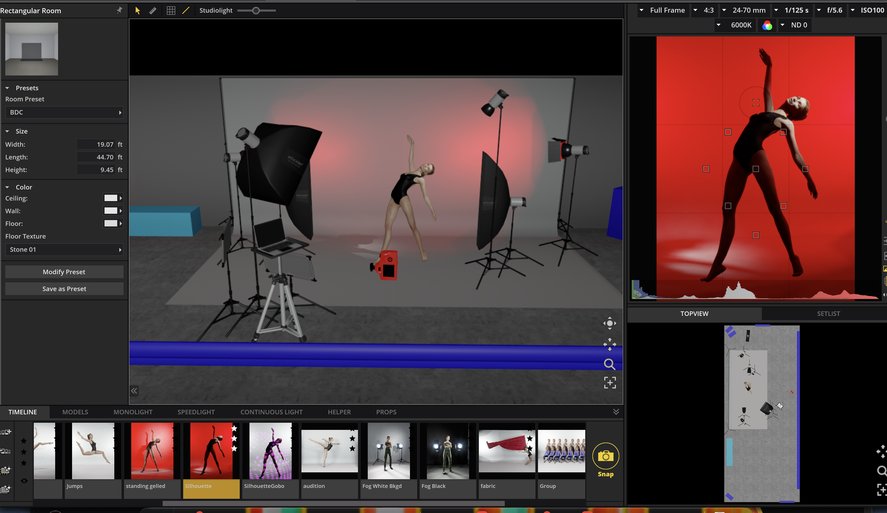
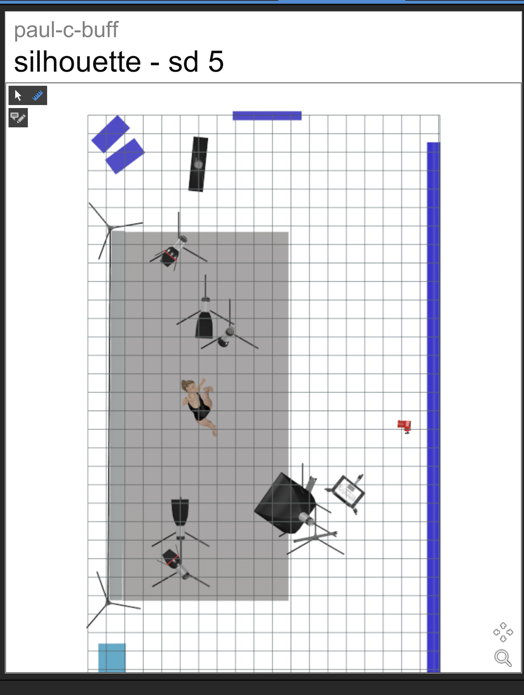
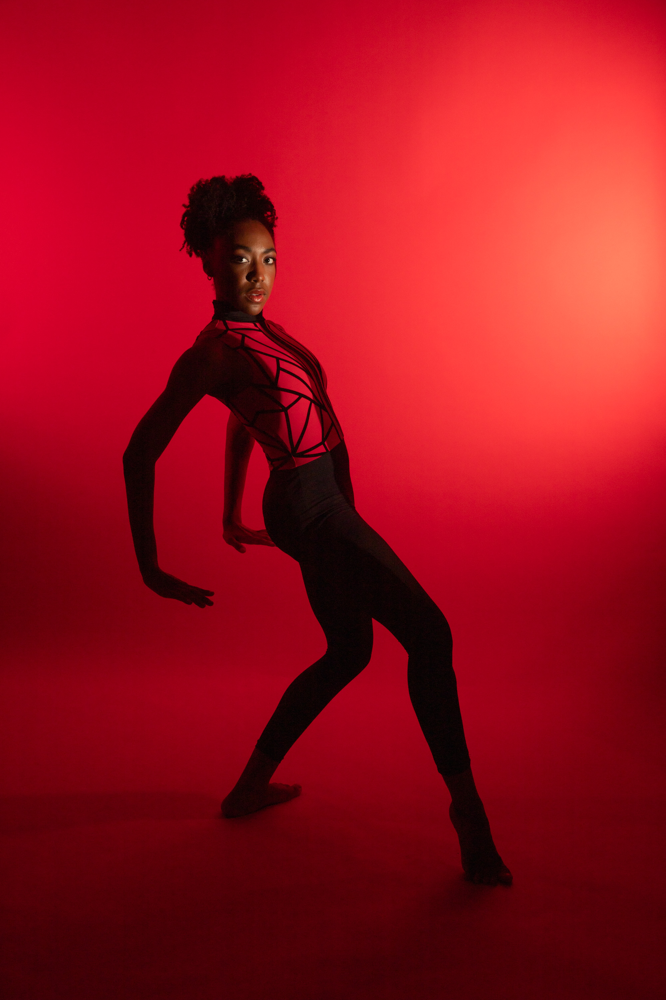

# ccwolfephoto Lighting Setup Kit

A set of tools to help setup photographic studio flashes on set of Dance Photography shoots.

## What's Here

### Set-A-Light 3D Layouts

SAL 3D (a commericial software from Elixxer - [homepage](https://www.elixxier.com/en/set-a-light-3d/)) is a photographic lighting simulator - a magical pretend photo studio right on your computer. You can play with as many lights and light modifiers as you want, and move models around freely. I use it to experiment and come prepared to set without wasting anyone's time.

#### [paul-c-buff.set](set-a-light-3d/paul-c-buff.set)

Describes a 7-light setup, with setups for:

* Floorwork
* Standing
* Kicks
* Jumps
* Groups
* Fabric
* Fog
* Silhouette

Example shown for Silhouette:

## ccwolfephoto Equipment list

This is what I have, and so you'll see the setups reflect that. My hope is that future contributors will contribute setups that use other sets of (potentially more common) equioment.

### Paul C Buff

#### Lights

* 5 Einstein 640 W/S Corded Monolights
* 2 Celestial 600 W/S Battery-Operated Monolights

#### Light Modifiers

* 2 60" Stripboxes
* 1 36" Mini Stripbox
* 1 36" Rectangular Softbox
* 1 45" Octobox
* 2 7" Relfectors
* 1 set of grids, 10, 20, 30 degrees to fit 7" reflectors
* 2 Gel holders w/ gels
* 1 Snoot
* 1 Gobo projector

#### Light Stands

* 1 17' Boom
* Assorted stands

#### Transmitters

* 2 Cyber Commanders

### Godox

#### Lights

* 2 AD200 Pro II Battery-Powered Monolights
* 3 IT32 On/Off Camera Mini Speedlights

#### Transmitters

* X3O, X3C mini GUI controllers

## Contributing

### To Make a Suggestion or Request

Open a GitHub Issue. You'll need a GitHub account, which is free. You don't have to know anything about GitHub or software development to do so.

### To Chat with the Developers

Contact ccwolfephoto via FaceBook Messenger or Instagram messenger.

### To contribute configurations

Ideally, you'll need to know how to use github.  Search the internet for how to "fork, clone, branch, commit, push, then open a pull request".  Lots of guides out there. That's the usual way to contribute to open source projects.  And thank you!

If that's way too hard, you can chat with the developers and send us the files. But please make an effort!

## License

See [LICENSE](LICENSE). GPL3, which means anyone can use it, and anyone can share it, and anything you contribute is permanently shareable.

## Copyright

Copyright (c) 2026-current year ccwolfephoto and contributors. Usage subject to license.